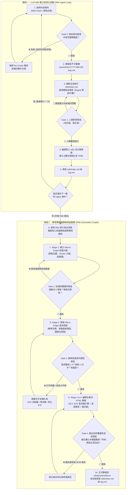

# 作業報告：建立「後端與資料工程實務 LLM Wiki」與教學型 HTML 簡報（含 Workflow Loop / Graph 設計與反思）

---

## 一、LLM Wiki 主題與簡短介紹

### 1.1 主題名稱
**後端、資料工程、雲端基建與跨職能協作實務知識庫（Backend & Data Engineering Practical LLM Wiki）**

### 1.2 核心理念與解決痛點
在軟體工程團隊中，新手後端與資料工程師常面臨一個巨大的斷層：**「看懂了官方文件的 Hello World，卻在真實生產環境（Production）的高併發、分散式交易與跨部門協作中頻頻踩坑」**。傳統的筆記散落在個人書籤或一次性 AI 問答中，缺乏跨領域的因果連結（例如：不知道一個 Redis 20MB 的 BigKey 竟會連鎖導致 Kubernetes HPA 擴縮容失靈）。

本專案採用 Andrej Karpathy 提出的 **LLM Wiki（Compounding Knowledge Artifact）** 架構，建立一座**「拒絕空泛教科書定義、專注於工程實務 Trade-offs、配置範例與真實事故覆盤」**的結構化知識庫：
- **三層式不可變架構**：
  1. **規範層（`AGENTS.md`）**：定義知識庫的 Schema、Obsidian 雙向連結規範（`[[wikilinks]]`）、YAML Frontmatter 標籤與標準操作工作流（Ingest / Query / Lint）。
  2. **不可變原始層（`raw/`）**：存放所有外部收集的原始技術文章與事故紀錄（只讀不改，作為單一事實來源 Source of Truth）。
  3. **LLM 編譯維護層（`wiki/`）**：由 AI 將原始素材拆解並交叉引用至 6 大知識型態目錄（`sources/`、`concepts/`、`tools/`、`playbooks/`、`postmortems/`、`comparisons/`），並透過全局索引 `wiki/index.md` 與時間軸日誌 `wiki/log.md` 追蹤每一次知識演進。
- **「先討論、後生成」的半自動建立機制**：每次消化新資料（Ingest）皆分為兩階段——AI 先讀取原始文章並提出「核心實務提煉與預計變更清單」，待人類確認方向與跨頁關聯後，才正式編譯寫入 `wiki/` 並更新索引。

---

## 二、LLM Wiki 成果與教學 HTML 簡報連結

> 📌 **GitHub Repository 與 GitHub Pages 線上連結**：
> - **GitHub 專案總覽（含完整 `raw/` 與 `wiki/` 知識庫）**：https://github.com/Cy332/LLM_wiki_engineer
> - **LLM Wiki 全局索引頁（`wiki/index.md`）**：https://github.com/Cy332/LLM_wiki_engineer/blob/main/wiki/index.md
> - **教學 HTML 簡報 v1（經典 12 頁線性章節教學版）**：https://cy332.github.io/LLM_wiki_engineer/wiki/presentations/backend-onboarding-slides.html
> - **教學 HTML 簡報 v2（修改 Graph 流程後之 14 節點知識星系圖雙模式版）**：https://cy332.github.io/LLM_wiki_engineer/wiki/presentations/backend-onboarding-graph-slides.html

### 2.1 LLM Wiki 建置成果統計（共 Ingest 7 篇原始資料，編譯 19 篇 Wiki 頁面）
我們超越作業「至少 Ingest 5 篇」的要求，橫跨後端、資料庫、快取、K8s、資料工程與跨職能協作 **6 大領域**，共收集並消化了 **7 篇高品質技術專文**，編譯為 **19 篇高度互連的 Wiki 頁面**：

| 知識庫層級與目錄 | 檔案數量 | 包含頁面與核心內容 |
| :--- | :---: | :--- |
| **`raw/articles/`** （不可變原始素材層） | **7 篇** | 1. `2026-11-12-advanced-git-johnliu.md`（進階 Git 內部原理與分支策略） 2. `2026-11-12-cache-strategies-johnliu.md`（快取讀寫策略與三大異常防護） 3. `2026-11-12-container-orchestration-k8s-johnliu.md`（容器編排演進與 K8s 架構） 4. `2026-11-12-medallion-architecture-databricks-pipeline.md`（Medallion 三層資料湖倉管線） 5. `2026-11-12-postgresql-outbox-pattern-revamped.md`（PostgreSQL Outbox 分區表優化） 6. `2026-11-12-redis-hotkey-bigkey-titansoft.md`（鈦坦科技 Redis Hotkey/BigKey 事故排查） 7. `2026-11-12-how-to-work-with-qa-3pmlab.md`（PM/Eng/QA 跨職能協作與品質內建） |
| **`wiki/sources/`** （原始來源結構化摘要） | **7 篇** | 對應上述 7 篇原始文章的實務重點提煉與雙向引用錨點。 |
| **`wiki/concepts/`** （核心架構與演算法模式） | **3 篇** | - `caching-strategies-and-pitfalls.md`（Cache-Aside / Write-Behind 與穿透、擊穿、雪崩防護） - `transactional-outbox-pattern.md`（分散式交易雙寫問題與分區表 Outbox 架構） - `medallion-architecture.md`（Bronze ➔ Silver ➔ Gold 三層事件串流湖倉架構） |
| **`wiki/tools/`** （技術棧底層原理與調優） | **4 篇** | - `git.md`（Blob/Tree/Commit DAG 圖結構、Rebase 黃金法則與 Bisect） - `redis.md`（單執行緒 I/O Multiplexing、BigKey 阻塞與記憶體內碎片） - `postgresql.md`（MVCC 多版本併發控制、Dead Tuples 與 Autovacuum 調優） - `kubernetes.md`（Control Plane / Worker Node、Service 網路與 HPA 陷阱） |
| **`wiki/playbooks/`** （實戰 SOP 與跨職能規範） | **2 篇** | - `git-version-control-and-history-management.md`（PR 規範、Squash Merge 與緊急救援） - `cross-functional-collaboration-pm-eng-qa.md`（DoR/DoD、測試左移與 Feature Flags 灰度發布） |
| **`wiki/postmortems/`** （真實線上事故覆盤） | **1 篇** | - `2026-11-12-redis-hotkey-bigkey-cluster-failover.md`（20MB Gzip BigKey 導致單核 100% 與集群不斷主從切換之完整排查鏈） |
| **`wiki/comparisons/`** （技術選型對比與決策樹） | **2 篇** | - `container-orchestration-compose-vs-swarm-vs-k8s.md`（容器編排三階段演進對比） - `ingress-vs-api-gateway.md`（K8s Ingress 與 API Gateway 職責邊界對比） |
| **全局管理與簡報輸出** | **4 份** | - `wiki/index.md`（全局分類目錄）、`wiki/log.md`（操作日誌） - `wiki/presentations/backend-onboarding-slides.html`（第一版：12 頁經典章節教學簡報） - `wiki/presentations/backend-onboarding-graph-slides.html`（第二版：14 節點知識圖譜雙模式簡報） |

---

### 2.2 教學 HTML 簡報雙版本設計與「Wiki ⇄ 簡報內容」明確對應表

為了讓原本不熟悉後端與資料工程實務的新手能循序漸進理解，同時展現我們在**「步驟四：反思與修改 Workflow Graph」**前後的演進成果，我們在專案中完整保留了兩個版本的互動式 HTML 教學簡報：

1. **第一版（v1 經典線性章節教學版：`backend-onboarding-slides.html`）**
   - **教學定位**：以新手入職第一天到系統上線的 5 大學習模組為主軸（共 12 頁），支援左側章節大綱收合、鍵盤翻頁、深淺色模式（`D` 鍵）與講者備忘錄（`N` 鍵，內含白話口語講稿幫助初學者理解）。
2. **第二版（v2 知識圖譜雙模式教學版：`backend-onboarding-graph-slides.html`）**
   - **教學定位**：經反思修改 Workflow Graph 後產出的進化版（共 14 個知識節點）。畫面左側為 **Macro-Graph（互動式 SVG 知識星系圖）**，呈現節點間的跨領域因果邊（例如點擊 `N11 Redis BigKey 事故` 會自動高亮它如何跨領域害死 `N08 K8s HPA`）；畫面右側為 **Micro-Graph（全視覺化架構流程圖投影片）**，將複雜原理轉化為直覺的對比圖與時序圖，支援 `Split`（雙欄）、`G`（全幅星系圖）、`S`（專注投影片）三種模式切換。

#### 【Wiki 知識頁面 ⇄ 教學簡報 v1 / v2 節點明確對應表】

| 教學模組 / 領域 | 簡報 v1（12 頁線性版）對應頁碼 | 簡報 v2（14 節點圖譜版）對應節點 | 明確引用的 Wiki 知識庫頁面 (`wiki/...`) | 核心教學傳遞概念（初學者收穫） |
| :--- | :--- | :--- | :--- | :--- |
| **總覽導覽** | Slide 01: 封面與學習藍圖 Slide 12: 總結與黃金守則 | `N01` 後端與資料工程實務全景圖 | `[[index]]` | 建立從「寫出能跑的 Code」到「打造高可用分散式系統」的全局地圖。 |
| **模組一：版本控制與協作基石** | Slide 02: Git 底層圖結構與分支策略 Slide 03: Rebase 黃金法則與 Bisect 排查 | `N02` Git DAG 圖結構與分支策略 `N03` Rebase 黃金法則與救急工具箱 | `[[tools/git]]` `[[playbooks/git-version-control-and-history-management]]` | 理解 Git Commit 是快照與指標而非純 diff；掌握何時該用 Merge vs Rebase，以及用 `reflog` / `bisect` 救回誤刪與抓蟲。 |
| **模組二：跨職能研發與上線守護** | Slide 04: PM / Eng / QA 品質內建與測試左移 Slide 05: Feature Flags 灰度發布與解耦 | `N04` 跨職能協作：測試左移與 DoR/DoD `N05` Feature Flags：部署與發布解耦 | `[[playbooks/cross-functional-collaboration-pm-eng-qa]]` | 破除「寫完丟給 QA 測」的穀倉效應；學會用 Feature Toggle 將高風險大改版拆解為可秒級降級的漸進式發布。 |
| **模組三：K8s 容器編排與雲端基建** | Slide 10: 容器編排演進與 K8s 核心架構 Slide 11: K8s 網路邊界與 HPA 避坑指南 | `N06` 容器編排演進與 K8s 核心架構 `N07` K8s 流量邊界：Service、Ingress 與 API Gateway `N08` K8s 資源管理與 HPA 自動擴縮容陷阱 | `[[tools/kubernetes]]` `[[comparisons/container-orchestration-compose-vs-swarm-vs-k8s]]` `[[comparisons/ingress-vs-api-gateway]]` | 搞懂 Pod / Deployment / Service / Ingress 關係，以及為何 K8s `requests` 設太高或依賴外部阻塞資源會讓 HPA 完全失靈。 |
| **模組四：快取架構與 Redis 事故實戰** | Slide 06: 快取讀寫策略與三大異常防護 Slide 07: Redis 單執行緒與 BigKey 連環爆 | `N09` 快取讀寫策略：Cache-Aside vs Write-Behind `N10` 快取三大災難：穿透、擊穿與雪崩防護 `N11` 事故覆盤：Redis 20MB BigKey 擊穿集群與 HPA | `[[concepts/caching-strategies-and-pitfalls]]` `[[tools/redis]]` `[[postmortems/2026-11-12-redis-hotkey-bigkey-cluster-failover]]` | 認識快取穿透/擊穿/雪崩的防禦對策；透過真實 20MB BigKey 事故理解 Redis 單執行緒阻塞如何引發主從切換風暴。 |
| **模組五：交易一致性與資料湖倉管線** | Slide 08: PostgreSQL MVCC 與死元組調優 Slide 09: Transactional Outbox 分區表實戰 *(註：v1 漏掉了 Medallion 架構)* | `N12` PostgreSQL MVCC、Dead Tuples 與 Vacuum 調優 `N13` 分散式一致性：Transactional Outbox 分區表 `N14` 資料工程：Medallion 三層事件湖倉管線 | `[[tools/postgresql]]` `[[concepts/transactional-outbox-pattern]]` `[[concepts/medallion-architecture]]` | 理解為何 `UPDATE` 在 PG 底層是 `DELETE+INSERT`；如何用本地 ACID 交易 + 分區表 Outbox 解決 DB 與 Kafka 雙寫不一致，並串接至 Bronze/Silver/Gold 資料湖倉。 |

---

## 三、Loop / Graph 流程設計說明

為了確保外部雜亂的技術文章能夠「零幻覺、不遺漏、結構化」地轉化為 LLM Wiki，並進一步編譯成高品質的教學 HTML 簡報，我們將核心主幹流程 **「取得資料 ➔ 查詢 Wiki ➔ 整理重點 ➔ 檢查內容 ➔ 產生簡報」** 拆解並擴充為一套包含 **「雙迴圈（Dual Loops）＋ 四道檢查閘門（4 Gate Checks）」** 的有向圖工作流（Workflow Graph）：

1. **取得資料（Data Acquisition）**：從外部技術部落格與官方文件擷取原始文章，通過 `Gate 0` 完整性檢查後存入不可變層 `raw/articles/`。
2. **查詢 Wiki（Query & Context Alignment）**：讀取全局索引 `wiki/index.md` 與既有知識頁，透過 `Gate 1`（先討論、後生成）確認新增與更新範圍後，編譯寫入 `wiki/` 並建立 `[[雙向連結]]`。
3. **整理重點（Macro & Micro Structuring）**：盤點 Wiki 全域知識，先規劃 **Macro-Graph 節點拓撲大綱** 與 **Micro-Graph 逐頁視覺規格**。
4. **檢查內容（Multi-Stage Gate Verification）**：在寫入 HTML 程式碼前，依序執行 `Gate 2`（Wiki 覆蓋率與跨領域連結檢查）與 `Gate 3`（單頁字數 ≤ 3 點與圖表規格檢查），未通過即退回重構。
5. **產生簡報（Compile & Versioned Export）**：編譯互動式 HTML 簡報，並通過 `Gate 4`（防覆蓋版本檢查與 DOM 渲染驗證）後正式歸檔至 `wiki/presentations/`。

### 3.1 整體系統架構與執行流程圖（Mermaid Graph）

---

### 3.2 關鍵設計解析：重複執行步驟、檢查點與設計原因

#### 1. 哪些步驟會重複執行（Loops）？
- **迴圈 A：多源資料消化迴圈（Multi-Source Ingest Loop，步驟 1 ➔ 5）**
  - 每當引入一篇新文章時，都會重複執行「抓取與檢查 ➔ 存入 `raw/` ➔ 對照既有 `wiki/index.md` 提出更新計畫 ➔ 編譯寫入 `wiki/` 並建立跨頁 `[[雙向連結]]`」。在本專案中，此迴圈共執行了 7 次，讓知識庫如同滾雪球般累積（Compounding），後進入的文章會自動反向更新前面已建立的工具頁（例如：第 6 篇的 Redis 事故文章，自動回頭更新了第 2 篇建立的 `redis.md` 與第 3 篇的 `kubernetes.md`）。
- **迴圈 B：逐頁規格精煉與視覺化迴圈（Micro-Graph Slide Refinement Loop，步驟 8 ➔ Gate 3）**
  - 對簡報中的每一個教學節點（`N01`～`N14`），重複執行「從對應 Wiki 頁面抽取核心痛點 ➔ 轉換為視覺化架構圖（流程圖/時序圖/對比表）➔ 撰寫底部初學者白話講稿 ➔ 通過字數與密度檢查」。

#### 2. 哪些地方需要檢查或重新生成（Gate Checks & Retries）？
我們在工作流中設置了 **4 道強制檢查閘門（Gates）**，只要未達標就立即觸發退回重新生成（Retry）：
- **`Gate 0`（原始素材完整性檢查）**：在寫入 `raw/` 前，檢查抓回來的 Markdown 行數與技術段落是否完整。若因網站快取或防爬蟲只抓到幾行空殼（如我們在抓 Databricks 時遇到的狀況），立即觸發 `X-No-Cache` 重新擷取。
- **`Gate 1`（人類對齊檢查 — 先討論、後生成）**：在寫入 `wiki/` 前暫停，由人類檢視 AI 提出的「3~5 點實務提煉」與「預計新增/修改頁面清單」，避免 AI 偏離主題或產生無用頁面。
- **`Gate 2`（Macro-Graph 知識覆蓋率與孤兒節點檢查）**：在開始寫簡報內文前，先檢查簡報節點是否 100% 覆蓋 `wiki/index.md` 的六大領域？每個節點是否都有明確對應的 `wiki/` 檔案路徑？跨領域的因果連結（Cross-cluster edges）是否建立？
- **`Gate 3`（Micro-Graph 教學可讀性與字數檢查）**：檢查每一頁簡報是否符合「單頁核心結論 1 句話、重點卡片 ≤ 3 點、每點 ≤ 25 字、必備 1 張結構化圖表與講者備忘錄」。若 AI 塞入大段文字，強制退回重寫並轉為圖表。
- **`Gate 4`（輸出前版本防覆蓋與渲染檢查）**：在寫入 `wiki/presentations/` 前，檢查目標檔名是否已存在（防止覆蓋舊版成果），並驗證 HTML 內所有節點 ID、鍵盤事件與深淺色切換是否正常運作。

#### 3. 為什麼這樣設計？（核心設計哲學）
1. **防止 Context Window 污染與幻覺（Anti-Hallucination）**：若不先建立結構化的 `wiki/`，而是把 7 篇長文章（數萬字）一次丟給 AI 叫它「直接做一份 HTML 簡報」，AI 極易抓錯重點、遺漏細節或編造配置數據。透過 `raw/ ➔ wiki/ ➔ presentations/` 的分層編譯，簡報生成階段只需讀取高純度的 Wiki 頁面。
2. **「缺陷左移（Shift-Left Verification）」節省重工成本**：寫一份上千行的互動式 HTML 簡報成本很高。如果在最後寫完 HTML 才發現「漏了一個章節」或「文字太多像 Word 檔」，整份程式碼都要打掉重練。將檢查點前移到 **大綱拓撲（Gate 2）** 與 **單頁規格（Gate 3）**，能在動手寫 HTML 前就攔截 90% 的結構錯誤。
3. **讓知識具備「網路效應」而非單純條列**：透過 Graph 結構設計，簡報不再只是死板的線性翻頁，而能呈現真實工程世界中「資料庫、快取、K8s 與團隊流程」環環相扣的系統全貌。

---

## 四、一次實際執行的結果與檢查紀錄

以下為我們在執行本工作流時的真實檢查紀錄（擷取自專案中的 `wiki/log.md` 與五階段 Graph 執行驗收表）：

### 4.1 階段一（Wiki Ingest Loop）實際執行紀錄
- **執行動作**：分兩波執行 Ingest（第一波單篇 Git 文章驗證流程；第二波批次抓取快取、K8s、Medallion、PostgreSQL Outbox、Redis BigKey 事故、QA 協作共 6 篇）。
- **Gate 0 攔截紀錄**：
  - 在抓取第 4 篇 Databricks Medallion Architecture 時，首次透過 `r.jina.ai` 擷取回傳僅 **10 行（597 bytes）**，內容僅為網頁標題與廣告追蹤碼。
  - **觸發重試**：Gate 0 判定為無效空殼內容，立即改用 `-H "X-No-Cache: true"` 重新抓取 Databricks 官方 Glossary 頁面，並額外結合 Medium 上《Building a Medallion Architecture Data Pipeline with Kafka, MinIO & Airflow》實作專文，成功組合成 **121 行完整架構與配置素材**，存入 `raw/articles/2026-11-12-medallion-architecture-databricks-pipeline.md`。
- **Gate 1 對齊與編譯結果**：
  - 向使用者提交涵蓋 6 大領域的「Ingest 摘要與預計變更清單（新增 6 篇 `sources/`、10 篇核心頁面、更新 2 篇既有頁面）」。
  - 獲確認後一次編譯完成，全數通過 YAML Frontmatter 與 `[[雙向連結]]` 檢查，零孤兒頁面。

### 4.2 階段二（Slide Generation Graph）五階段 Gate Check 實際驗收表

| 執行階段                            | 檢查閘門 (Gate)                        | 檢查項目與量化標準                                                         |   實際檢查結果   | 數據與產出證明                                                                                                         |
| :------------------------------ | :--------------------------------- | :---------------------------------------------------------------- | :--------: | :-------------------------------------------------------------------------------------------------------------- |
| **Stage 1** Macro-Graph 拓撲定義 | **Gate 2** 覆蓋率與孤兒檢查             | 1. 是否涵蓋 `index.md` 全 6 大領域？ 2. 每個節點是否皆有 ≥ 1 條連線與對應 Wiki 路徑？    | ✅ **PASS** | 共定義 **14 個節點 (`N01`~`N14`)**、5 大色彩群集 (Clusters)、**17 條有向邊**（含 13 條主幹邊 + 4 條跨領域虛線邊），100% 對應 12 篇核心 Wiki 頁面。      |
| **Stage 2** Micro-Graph 逐頁規格 | **Gate 3** 密度與圖表規格檢查            | 1. 每頁重點卡片是否 ≤ 3 點？ 2. 每點文字是否精簡不超過 25 字？ 3. 每頁是否皆指定專屬視覺圖表？   | ✅ **PASS** | 14 個節點全數採用「左/上視覺化架構圖 + 右/下 3 點精煉守則」佈局（如 `N11` 採用 5 步事故骨牌鏈、`N13` 採用本地 ACID 分區表對比圖）。                              |
| **Stage 3 & 4** 雙模式引擎與內容編譯   | **Gate 4 (Part A)** DOM 與互動綁定檢查 | 1. 14 個 SVG 節點與 14 頁 Slide DOM 是否完整對應？ 2. 切換節點時是否同步高亮鄰居邊與底部講稿？ | ✅ **PASS** | 實測點擊左側星系圖任一節點或按 `←`/`→` 鍵，右側投影片、頂部進度條、關聯 Wiki 膠囊標籤與底部白話備忘錄皆毫秒級同步更新。                                             |
| **Stage 5** 版本輸出與索引回寫        | **Gate 4 (Part B)** 版本防覆蓋檢查     | 1. 新版檔案是否與舊版獨立命名並存？ 2. 是否同步登記至 `wiki/index.md` 與 `log.md`？     | ✅ **PASS** | 獨立產出 `backend-onboarding-slides.html` (v1, 12 頁) 與 `backend-onboarding-graph-slides.html` (v2, 14 節點)，並更新索引與日誌。 |

---

## 五、反思：哪個節點最常出錯？如何調整檢查流程與修改 Graph？

在完成第一次實際執行並檢視成果後，我們進行了深度覆盤，找出了工作流中最容易出錯的 **兩個關鍵節點**，並實際執行了**「將檢查點往前移（Shift-Left）」**與**「修改 Workflow Graph」**的迭代升級：

### 反思案例一：【簡報生成節點出錯 ➔ 將檢查前移至「大綱與圖譜拓撲設計階段」】

1. **哪一個節點最常出錯？（問題現象）**
   - 在第一版（v1）製作教學簡報時，我們的流程較為線性：直接讓 AI「讀取 Wiki ➔ 規劃 12 頁章節大綱 ➔ 直接寫出整份 HTML 簡報程式碼」。
   - 結果在檢視第一版成品（`backend-onboarding-slides.html`）時，發現了 **三個結構性問題**：
     - **(a) 知識庫覆蓋率遺漏**：Wiki 中明明已經建立了 `data-eng` 領域的 `[[concepts/medallion-architecture]]`（Bronze/Silver/Gold 資料湖倉架構），但在生成 12 頁線性簡報時被漏掉了，沒有對應的投影片。
     - **(b) 跨領域因果關係斷裂**：在 Wiki 的事故覆盤中，有一個極具教學價值的跨領域關聯——**「Redis 的 20MB BigKey 阻塞（資料庫領域）會導致 API Pod 等待 I/O 而 CPU 維持低檔，進而害死 Kubernetes HPA 無法觸發擴容（雲端基建領域）」**。但在線性章節簡報中，Redis 在第 7 頁、K8s 在第 11 頁，初學者很難看出兩者的因果連鎖反應。
     - **(c) 單頁文字密度容易失控**：直接生成 HTML 時，AI 傾向把 Wiki 內的段落直接搬進條列清單，導致部分頁面文字偏多。

2. **發現問題後，把檢查往前移到了哪一個步驟？（Shift-Left 調整）**
   - 我們意識到：**「不能等到 HTML 程式碼都寫完了才來檢查內容有沒有漏、結構清不清楚」**。
   - 因此，我們把檢查點從最後的「成品檢視」大幅**往前移到寫任何一行 HTML 程式碼之前**，拆解並插入了兩道前置檢查閘門：
     - **前移檢查點 1（`Gate 2：Macro-Graph 覆蓋率與跨領域連結檢查`）**：在規劃階段強制先畫出節點拓撲表，核對 `wiki/index.md` 的所有核心頁面是否皆已納入節點（因此抓出並補上了 `N14 Medallion 資料湖倉管線`），並強制標出跨群集的因果邊（如 `N11 Redis BigKey ➔ N08 K8s HPA`、`N13 Outbox ➔ N14 Medallion`）。
     - **前移檢查點 2（`Gate 3：Micro-Graph 單頁視覺規格與字數上限檢查`）**：規定在進入 HTML 編碼前，必須先定義好每一頁要用哪種視覺圖表（流程圖、時序圖、對比矩陣），且條列卡片嚴格限制 `≤ 3 點、每點 ≤ 25 字`，多餘的解釋全部移入底部的「講者備忘錄（Speaker Notes）」。

3. **你有沒有因此修改 Workflow / Graph？為什麼？**
   - **有！** 我們將原本單純的「查詢 Wiki ➔ 寫大綱 ➔ 產生 HTML」三步線性流程，正式重構為 **「五階段雙層圖譜工作流（Macro-Graph 拓撲對齊 ➔ Gate 2 ➔ Micro-Graph 視覺規格 ➔ Gate 3 ➔ 雙模式 HTML 編譯）」**，並據此產出了第二版簡報 `backend-onboarding-graph-slides.html`。
   - **為什麼這樣改？** 因為教學簡報的核心目的是「降低初學者的認知負荷並建立系統全局觀」。將檢查前移至拓撲與規格階段，不僅徹底消除了遺漏頁面的問題，更讓最終產出的簡報兼具「宏觀星系導覽（看見跨領域關聯）」與「微觀視覺圖解（一眼看懂運作原理）」的教學效果。

---

### 反思案例二：【檔案輸出節點出錯 ➔ 新增「版本防覆蓋檢查（Artifact Versioning Check）」】

1. **哪一個節點出錯？（問題現象）**
   - 當我們設計好新的五階段 Graph 工作流並實際執行產出第二版簡報時，因為在最後的「檔案輸出節點（Write File）」沿用了第一版的目標路徑 `wiki/presentations/backend-onboarding-slides.html`，導致第二版的程式碼**直接覆蓋掉了第一版的 12 頁經典版簡報**。

2. **發現問題後，如何把檢查往前移並修改 Workflow？**
   - 發現覆蓋問題後，我們立即復原了第一版簡報，並在工作流的「檔案寫入節點」**之前**新增了 **`Gate 4：輸出前版本防覆蓋檢查（Pre-Write Artifact Versioning Check）`**：
     - **規則修改**：當工作流演進或採用不同渲染模式（如 Linear Slide vs. Graph Slide）產出新簡報時，輸出節點必須先檢查 `wiki/presentations/` 下是否已有同名檔案。若有，必須以語意化後綴區分命名（因此將第一版保留為 `backend-onboarding-slides.html`，第二版獨立命名為 `backend-onboarding-graph-slides.html`），並同步在 `wiki/index.md` 與 `wiki/log.md` 登記雙版本脈絡。
   - **為什麼這樣改？** 在工程實務與迭代實驗中，保留不同版本的工作流產物（Artifacts）至關重要——這不僅防止了心血結晶被誤刪，更讓這兩個並存的 HTML 檔案成為我們**「工作流改良前後（v1 線性流程 vs. v2 Graph 流程）」最直接、可實際點擊對比的鐵證**！

---

## 六、實作心得與總結

透過這次從零打造「後端與資料工程實務 LLM Wiki」並將其編譯為互動式教學 HTML 簡報的實作過程，我有以下三點深刻的收穫與體會：

1. **從「一次性問答（RAG / Chat）」到「複利累積知識庫（Compounding Wiki）」的思維躍遷**
   過去使用 AI 整理技術資料時，往往是丟一篇文章、拿到一份摘要後就結束了，知識彼此孤立且容易遺忘。這次採用 `raw/`（不可變原始層）與 `wiki/`（結構化編譯層）分離的架構，並規定每次 Ingest 都必須更新全局索引 `index.md` 與建立跨頁 `[[雙向連結]]`，讓我親眼見證了知識庫的「網路效應」——當第 6 篇的 Redis BigKey 事故文章進入知識庫時，它不再只是一篇單獨的事故紀錄，而是自然地與前面建立的「快取穿透/雪崩概念」以及「Kubernetes HPA 擴縮容機制」串聯起來，形成真正貼近工程實務的立體知識網。

2. **「先討論、後生成」與「檢查左移（Shift-Left）」是控制 AI 產出品質的核心關鍵**
   在實作初期，我深刻體會到若讓 AI 跳過中間檢查、直接從大量資料生成最終的 HTML 簡報，很容易發生「遺漏特定領域頁面（如 v1 漏掉 Medallion 架構）」、「文字密度過高淪為大字報」、甚至「直接覆蓋掉舊版檔案」等失誤。當我們借鑑軟體工程中「測試左移（Shift-Left Testing）」的概念，將檢查點往前移到 **大綱拓撲階段（Gate 2）**、**單頁視覺規格階段（Gate 3）** 與 **寫入前版本檢查（Gate 4）** 後，不僅大幅降低了打掉重練的成本，也讓 AI 的產出變得高度可控且可預測。

3. **用「Graph 思維」做教學簡報，真正解決初學者「見樹不見林」的痛點**
   新手後端工程師在學習時，最怕把 Git、資料庫、Redis、K8s 當成互不相干的孤島來背誦。透過在反思後將工作流升級為「Macro-Graph（宏觀知識星系圖）+ Micro-Graph（微觀視覺流程圖）」雙模式簡報，閱讀者不僅能在單一頁面上透過視覺化圖表與白話備忘錄秒懂底層原理，更能隨時從左側的星系圖看出「原來一個上游的資料庫或快取設計不良，會如何像骨牌一樣擊穿下游的容器編排系統」。這種將「工作流設計（Workflow Graph）」與「知識呈現（Knowledge Graph）」合而為一的實作經驗，對我未來設計 AI Agent 流程與團隊知識管理都有極大的幫助！

