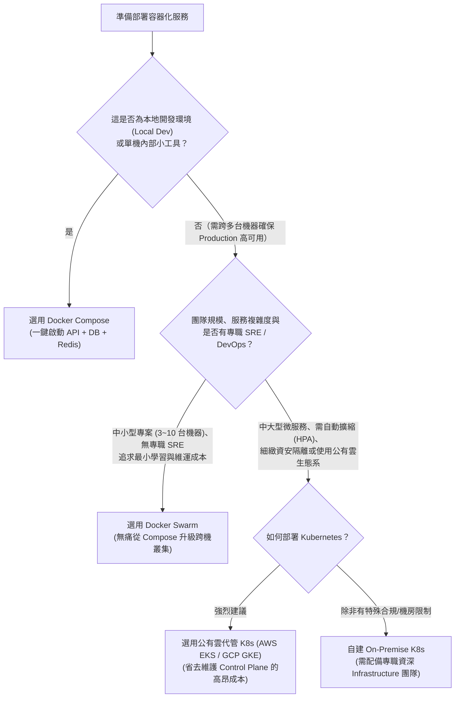

# 容器編排選型：Docker Compose vs Docker Swarm vs Kubernetes (K8s)

## 1. 選型背景

當團隊將應用程式容器化（Dockerized）之後，下一個面臨的基礎設施架構問題便是：**「我們該用什麼工具在開發環境、測試環境與正式環境（Production）管理這些容器？」**
許多團隊常在初期過度工程（只有 2 台機器、沒有專職 DevOps 卻硬上自建 K8s），或者在流量擴大後仍停留在單機 `docker-compose` 而面臨單點故障風險。本頁依據 [[sources/2026-11-12-container-orchestration-k8s-johnliu|容器管理協調系統實務]] 整理三者的多維度對比與決策樹。

---

## 2. 多維度技術對比表

| 評估維度 | Docker Compose | Docker Swarm | [[tools/kubernetes|Kubernetes (K8s)]] |
| :--- | :--- | :--- | :--- |
| **核心定位** | **單機**多容器定義與本地開發標準化工具 | Docker 內建的**輕量級跨機叢集**管理工具 | **業界公有雲標準**的大規模分散式容器編排平台 |
| **跨節點高可用 (Multi-Node HA)** | ❌ **不支援**（侷限於單一實體機/VM，機器掛了全掛） | ✅ **支援**（可跨多台 VM 自動分散副本與容錯） | ✅ **強大支援**（支援跨可用區 AZ、複雜拓撲與親和性調度） |
| **配置複雜度與學習曲線** | ⭐ **極低**（單一 `docker-compose.yml` 數十行搞定） | ⭐⭐ **低**（直接沿用 `docker-compose.yml` 加上 `deploy` 區塊即可） | ⭐⭐⭐⭐⭐ **極高**（需理解 Pod, Service, Ingress, ConfigMap, Probe 等眾多物件，YAML 動輒上百行） |
| **自我修復與探針機制** | 僅支援基礎 `restart: always` | 支援基礎健康檢查與容器重建 | 完整支援 `Liveness` / `Readiness` / `Startup Probe` 與細緻滾動更新控制 |
| **自動水平擴縮 (Autoscaling)** | ❌ 無 | ❌ 需靠外部腳本手動調整副本數 | ✅ 原生內建 **HPA**（依 CPU/Memory 或自訂指標自動擴縮）與 Cluster Autoscaler |
| **網路與資安隔離** | 單機 Bridge 網路 | 基礎 Overlay 跨機網路 | 支援 L7 `Ingress`、`NetworkPolicy` 微型防火牆、細粒度 `RBAC` 與雲端 `Workload Identity` |
| **第三方生態系整合** | 僅限本地開發工具鏈 | ⚠️ **逐漸萎縮**（許多現代監控、Service Mesh 與 GitOps 工具不再優先支援 Swarm） | 🌟 **絕對統治地位**（Prometheus, Istio, ArgoCD, 各大公有雲 EKS/GKE/AKS 全面原生支援） |
| **維運人力成本** | 零額外成本 | 低（後端工程師可兼任維護） | 自建極高；使用雲端代管（EKS/GKE）中等，但仍需具備 K8s 領域知識的 SRE/DevOps |

---

## 3. 選型決策樹 (Decision Tree)

### 具體場景建議
1. **什麼時候選 `Docker Compose`？**
   - 每個工程師筆電上的本地開發環境（一鍵拉起 Backend API + [[tools/postgresql|PostgreSQL]] + [[tools/redis|Redis]]）。
   - CI Pipeline 中跑 Integration Test 的臨時沙盒環境。
   - 流量極低、允許短暫停機備份的內部管理小工具（單台 VM 即可負荷）。
2. **什麼時候選 `Docker Swarm`？**
   - 專案從 1 台機器成長到 3~5 台機器，需要跨機器 Load Balancing 與抗單點故障，但**團隊只有幾位後端工程師、沒有專職 DevOps/SRE**，不想花數週學習 K8s 與改寫上百行 YAML。
3. **什麼時候選 `Kubernetes (K8s)`？**
   - 具備多個微服務、需要根據尖峰流量自動擴縮（`HPA`）、需要零信任網路隔離（`NetworkPolicy`）、Workload Identity 整合，或需要完整的可觀測性與 GitOps 生態系。
   - **實務鐵則**：除非公司有極度嚴格的金融/政府實體機房隔離要求，否則**優先採用雲端供應商代管的 K8s（如 AWS EKS、GCP GKE、Azure AKS）**，將最消耗心力的 Master Control Plane（etcd、API Server 升級與備援）交給雲端廠商維護。

---

## 4. 關聯頁面
- [[tools/kubernetes|Kubernetes (K8s) 容器編排與雲端原生基建實務]]
- [[comparisons/ingress-vs-api-gateway|Ingress 與 API Gateway 的職責邊界與對比]]
- [[sources/2026-11-12-container-orchestration-k8s-johnliu|來源摘要：後端工程師的第二堂課 (26) — 容器管理協調系統]]
