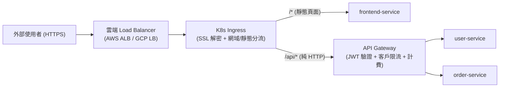

# Ingress 與 API Gateway 的職責邊界與架構對比

## 1. 選型與釐清背景

在設計微服務與 [[tools/kubernetes|Kubernetes (K8s)]] 架構時，許多工程師常將叢集入口的 **`Ingress`** 與業務架構中的 **`API Gateway`** 混為一談，甚至爭論「有了 Ingress 還需要 API Gateway 嗎？」。
事實上，兩者雖然底層都常基於 Reverse Proxy（如 NGINX、Envoy、Traefik、Kong），但在架構分層中分別屬於**「基礎設施網路層（Infrastructure Layer）」**與**「業務應用層（Application / Business Layer）」**。

---

## 2. 多維度對比表

| 比較維度 | Kubernetes Ingress | API Gateway |
| :--- | :--- | :--- |
| **架構定位** | **容器叢集的南北向網路入口** （將外部流量引導進 K8s 內部 `Service` 的橋樑） | **微服務對外的業務門面 (Facade)** （統一管控所有外部客戶端對後端 API 的存取行為） |
| **主要維護角色** | DevOps / SRE / 基礎設施團隊 | 後端架構師 / API 平台工程團隊 |
| **核心解決痛點** | 1. **省錢**：全叢集共用單一外部 Cloud Load Balancer，避免每個 Service 各租一個。 2. **統一憑證管理**：集中進行 **SSL/TLS 憑證卸載 (SSL Offloading)**，內部走純 HTTP。 3. **基礎 L7 路由**：依 Hostname 或 URL Path（如 `/api/v1/users`）轉發至對應 K8s Service。 | 1. **認證與授權 (AuthN / AuthZ)**：驗證 JWT Token、OAuth2、API Key。 2. **業務級限流與配額 (Rate Limiting & Quota)**：依用戶等級（免費版 vs 付費版）限制每分鐘呼叫次數。 3. **協議轉換與聚合**：如將外部 REST 轉為內部 gRPC、請求/回應格式改寫、API 計費統計。 |
| **常見代表工具** | NGINX Ingress Controller, Traefik, AWS ALB Ingress Controller | Kong, AWS API Gateway, Apigee, KrakenD, Envoy (搭配業務 Filter) |

---

## 3. 決策樹與共存架構 (How They Work Together)

### 3.1 兩者如何共存？
在中大型生產環境中，**Ingress 與 API Gateway 經常是串聯共存的**：

1. 外部 HTTPS 流量先經過雲端 Load Balancer 進入 K8s 的 **`Ingress`**。
2. **`Ingress`** 完成 SSL 解密，若路徑是一般網頁（`/`）就直接轉給 `frontend-service`；若路徑是 `/api/*`，則轉發給叢集內部的 **`API Gateway`**。
3. **`API Gateway`** 執行 JWT 權限驗證、檢查該名用戶是否超過 Rate Limit，通過後才將請求派發給底層的 `user-service` 或 `order-service`。

---

### 3.2 決策指南：什麼時候需要哪一個？

- **場景 A：中小型專案，認證與限流直接寫在後端框架 Middleware 裡**
  - **選擇**：**只需要 `K8s Ingress`**。
  - **原因**：如果單體服務或少數幾個微服務已經在應用程式內部（如 Spring Security、Express/NestJS Guard、Laravel Middleware）處理好 JWT 驗證與基本限流，那麼只需用 Ingress 處理 SSL 卸載與路徑轉發即可，無須多維護一層獨立的 API Gateway。
- **場景 B：多微服務架構、開放給第三方開發者 (Open API)，或需集中管控跨語言服務的認證與限流**
  - **選擇**：**`Ingress` + `API Gateway`（或採用二合一的現代 Gateway API / Kong Ingress Controller）**。
  - **原因**：避免在 Go、Python、Java 每個微服務裡重複實作一套 JWT 驗證與計費邏輯。近年 Kubernetes 官方也正在推動新一代 **Gateway API** 標準（以及像 Kong、Apisix 這類直接作為 Ingress Controller 運行的 API Gateway），讓兩層得以在架構上更緊密地融合。

---

## 4. 關聯頁面
- [[tools/kubernetes|Kubernetes (K8s) 容器編排與雲端原生基建實務]]
- [[comparisons/container-orchestration-compose-vs-swarm-vs-k8s|容器編排選型：Docker Compose vs Swarm vs Kubernetes]]
- [[sources/2026-11-12-container-orchestration-k8s-johnliu|來源摘要：後端工程師的第二堂課 (26) — 容器管理協調系統]]
