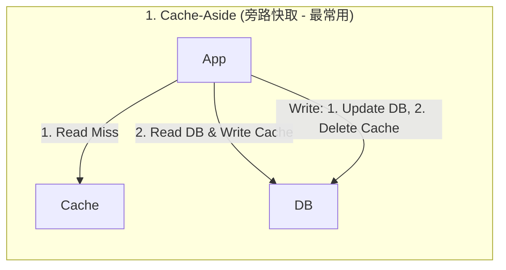

# 快取策略與三大災難防禦 (Caching Strategies & Pitfalls)

## 1. 核心解決什麼問題

在後端系統中，關聯式資料庫（如 [[tools/postgresql|PostgreSQL]]、MySQL）的磁碟與複雜查詢（`JOIN`、`GROUP BY`）回應時間通常在 **`ms`（毫秒）** 等級；而記憶體快取（如 [[tools/redis|Redis]]）則在 **`ns` ~ `us`（奈秒至微秒）** 等級，兩者效能差距達萬倍以上。

導入快取的核心目的有三個：
1. **降低回應延遲 (Low Latency)**：利用**時間局部性 (Temporal Locality)** 與**空間局部性 (Spatial Locality)**，將高頻讀取結果保存在記憶體或邊緣節點。
2. **保護脆弱的後端資料庫 (Shielding DB)**：攔截高達 99% 的重複讀取流量（例如將 1,000 RPS 降至 0.1 RPS），防止資料庫 CPU 與 Connection Pool 耗盡而卡死關鍵寫入交易（如下單、付款）。
3. **節省雲端與第三方 API 成本**：減少高規格 RDS 擴充需求，並快取按次計費的外部 API 回應（如匯率、天氣）。

---

## 2. 架構層級與三大讀寫模式

### 2.1 快取部署位置 (Where to Cache)

| 快取層級 | 代表技術 / 機制 | 適用資料類型 | 優勢 | 限制與 Trade-offs |
| :--- | :--- | :--- | :--- | :--- |
| **Client-Side (客戶端)** | Browser HTTP Headers (`Cache-Control`, `ETag`) | 靜態資源（Logo、CSS、JS） | 零網路請求，速度最快，完全不耗伺服器資源 | **無法強制客戶端立即失效**，若未做檔名 Hash 易讀到舊版 |
| **Edge (邊緣層)** | CDN (Cloudflare, CloudFront) | 靜態網頁、圖片、影音串流 | 全球就近存取、大幅降低跨國 Latency、吸收巨量頻寬 | 成本較高，不適合高度動態的個人化資料 |
| **Server In-Memory** | 應用程式自身 RAM (Guava, Node-cache) | 系統全域 Config、極少變動之字典表 | 無網路 I/O，伺服器端極致速度 | **多實例間無法共享**（容易出現資料不一致），Pod 重啟即消失 |
| **Distributed Cache** | [[tools/redis|Redis]], Memcached | 熱門貼文、商品資訊、Session、計算結果 | **多台 API 伺服器共享同一份快取**、可獨立高可用擴展 | 需經過一次內部網路 I/O（但仍遠快於查 DB） |

---

### 2.2 三大讀寫模式對比 (`Cache-Aside` vs `Write-Through` vs `Write-Back`)

| 模式名稱 | 讀取流程 (Read) | 寫入流程 (Write) | 適用場景 | 核心 Trade-offs 與坑點 |
| :--- | :--- | :--- | :--- | :--- |
| **Cache-Aside** *(最主流)* | App 先查 Cache；若 Miss，由 **App 自己查 DB 並寫入 Cache**。 | App **直接更新 DB**，接著 **「刪除」Cache**（等下次讀取時才重建）。 | 讀多寫少（電商商品、部落格、個人資料），可容忍微幅延遲。 | **為何寫入時用「刪除」而非「更新」快取？** 若短時間連續寫入 10 次卻無人讀取，更新快取會浪費 9 次無效計算與寫入；直接刪除只需等有人讀時算 1 次（Lazy Loading）。 |
| **Write-Through** *(直寫模式)* | App 只對 Cache 操作；Miss 時由 Cache 代理去讀 DB。 | App 寫入 Cache，**Cache「同步」寫入 DB**，兩邊皆成功才回傳。 | 對資料一致性要求極高（如金融帳戶、核心交易狀態）。 | 每次寫入都必須等待 DB 同步完成，**寫入延遲（Latency）較高**；且 Redis 原生不直接內建此代理機制，需於框架層封裝。 |
| **Write-Back** *(回寫模式)* | 同 Write-Through。 | App 寫入 Cache **立即回傳成功**；由 Cache 在背景**非同步批次 (Batch)** 寫入 DB。 | 寫入極度頻繁（Write-heavy）：IoT 感測器收集、點擊率、監控指標。 | 寫入吞吐量極致，甚至 DB 短暫維護也不影響前端；但**若快取節點在非同步落盤前當機，資料將永久遺失**，實作複雜度最高。 |

---

### 2.3 記憶體淘汰策略 (Eviction Policies)

當快取記憶體達到上限（如觸發 `maxmemory`），必須決定淘汰哪些舊資料：
- **TTL (Time-To-Live)**：為 Key 設定存活時間，到期自動失效。
- **LRU (Least Recently Used)**：基於「時間局部性」，淘汰**最久沒被存取**的資料（最通用，但偶發的批次掃描可能污染熱點資料）。
- **LFU (Least Frequently Used)**：基於「歷史存取頻率」，淘汰**總存取次數最少**的資料，能更精準保留真正的長期熱點（[[tools/redis|Redis]] 支援 `allkeys-lfu` 並可用於偵測 HotKey）。
- **FIFO (First-In, First-Out)**：先進先出，不管熱度。僅適合一次性通知或時間序列事件流。

---

## 3. 常見坑點：三大快取災難與防禦實務 (Gotchas)

在高併發環境下，快取失效或遭惡意請求時會引發三大經典線上事故：

| 災難名稱 | 觸發原因與現象 | 實戰防禦策略 |
| :--- | :--- | :--- |
| **1. 快取穿透** *(Cache Penetration)* | 大量請求查詢一個**「快取與資料庫都根本不存在」**的資料（例如惡意爬蟲掃描 `user_id = -1, -2...`）。由於 DB 查不到，不會寫入快取，導致每次請求都 100% 穿透打死 DB。 | 1. **快取空物件 (Cache Null)**：DB 查無資料時，仍將 `null` 寫入快取並設定較短的 TTL（如 30~60 秒）。 2. **布隆過濾器 (Bloom Filter)**：在快取前擋一層位元陣列，快速判斷 ID 是否可能存在。 |
| **2. 快取擊穿** *(Cache Breakdown)* | **單一超熱門的 Key (`HotKey`) 剛好在尖峰時刻過期（TTL 到期）**。瞬間成千上萬筆併發請求同時 Cache Miss，同時衝向 DB 執行高成本 SQL 重建快取，瞬間擊穿 DB。 | 1. **互斥鎖 (Mutex Lock)**：Cache Miss 時先去 Redis 搶分散式鎖（`SET NX`），只有搶到鎖的 1 個請求能查 DB 重建快取，其餘請求短暫 Sleep 後重試。 2. **邏輯過期 (Logical Expiration)**：HotKey 物理上不設 TTL，改在 Value 內存過期時間戳，發現過期時由背景非同步更新，前台先回傳舊值。 |
| **3. 快取雪崩** *(Cache Avalanche)* | **大量 Key 在同一時間集體過期**（例如批次預熱時設了相同的 1 小時 TTL），或者 **Redis 叢集節點直接當機**，導致全站流量瞬間雪崩式湧向 DB。 | 1. **TTL 加上隨機抖動 (Random Jitter)**：例如設定 `ttl = 3600 + random(0, 300)`，打散過期時間點。 2. **高可用架構與熔斷降級**：部署 Redis Cluster 主從備援；當快取層全面崩潰時，啟動 API 熔斷/限流（Rate Limiting），保護 DB 不被連帶拖垮。 |

> [!CAUTION] 第四種隱藏災難：HotKey + BigKey 複合風暴
> 除了上述三種「Cache Miss」造成的資料庫災難外，當快取「命中（Cache Hit）」時若遇到 **單一 Key 體積過大（BigKey，如 20MB）且訪問量極高（HotKey）**，會直接塞爆 Redis 單節點網卡頻寬、阻塞單執行緒並引發 OOM 與 Master-Slave 連環 Failover！真實案例請見：[[postmortems/2026-11-12-redis-hotkey-bigkey-cluster-failover|事故覆盤：Redis HotKey 與 20MB BigKey 引發叢集 Failover 與 K8s HPA 失靈]]。

---

## 4. 關聯頁面
- [[tools/redis|Redis 分散式快取與記憶體資料庫實務]]
- [[postmortems/2026-11-12-redis-hotkey-bigkey-cluster-failover|事故覆盤：Redis HotKey 與 20MB BigKey 引發叢集 Failover 與 K8s HPA 失靈]]
- [[sources/2026-11-12-cache-strategies-johnliu|來源摘要：後端工程師的第二堂課 (18) 資料加速: Cache]]
