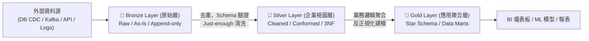

# Medallion Architecture (資料湖倉獎章分層架構)

## 1. 核心解決什麼問題

在現代資料工程與 **Data Lakehouse（資料湖倉）** 中，若將所有來自 API、CDC（Change Data Capture）、IoT 與業務資料庫的原始資料直接倒進資料湖並直接供 BI 報表查詢，會形成難以維護的「資料沼澤（Data Swamp）」——缺乏 Schema 驗證、重複資料充斥、一旦轉換邏輯寫錯就無法還原原始狀態。

**Medallion Architecture（獎章架構，又稱 Multi-Hop Architecture 多跳架構）** 是一種標準化的資料分層設計模式。它將資料管線切分為 **Bronze（青銅）➔ Silver（白銀）➔ Gold（黃金）** 三個邏輯層級，讓資料在流動過程中漸進式地提升結構化程度、乾淨度與商業價值。

---

## 2. 三層架構職責與資料建模對比

| 層級 | 定位與核心目標 | 資料處理與轉換原則 | 資料建模風格 (Data Modeling) | 主要使用者 / 消費端 |
| :--- | :--- | :--- | :--- | :--- |
| **🥉 Bronze Layer** *(青銅 / 原始層)* | **歷史封存與完全可重現性 (Auditability & Reprocessing)** | - **原封不動 (As-is)** 維持來源系統結構（如原始 JSON / Parquet）。 - 附加載入 Metadata（如 `_ingested_at`、`process_id`、`source_file`）。 - 採 Append-only 或快速 CDC 寫入，不丟棄任何欄位。 | 無固定建模（Raw Schema / 半結構化 Payload） | 資料工程師（Data Pipeline 自動觸發讀取，不開放一般分析師直接查詢） |
| **🥈 Silver Layer** *(白銀 / 企業視圖層)* | **全企業單一事實來源 (Enterprise View)** | - 執行 **「剛剛好 (Just-enough)」** 的清洗：去重（Deduplication）、處理 Null/缺失值、型別轉換、跨來源欄位對齊（Conformed）。 - 解決跨系統實體匹配（如統一 Master Customer、有效交易表）。 | 偏向 **3NF（第三正規化）** 或寫入優化的 **Data Vault** 模型 | 資料科學家（ML 特徵工程）、部門資料分析師（Self-service Ad-hoc 探索查詢） |
| **🥇 Gold Layer** *(黃金 / 應用聚合層)* | **業務就緒與極致讀取效能 (Consumption-Ready)** | - 套用複雜且專案專屬的商業規則（Business Rules）、KPI 計算與最終資料品質檢核（Data Quality Assertions）。 - 大幅減少查詢時的執行期 `JOIN`。 | 高度反正規化（Denormalized）：**Kimball 星狀綱要 (Star Schema)** 或 **Inmon Data Marts** | 高階主管 Dashboard、BI 報表工具（Looker / Tableau）、推薦系統 API |

---

## 3. 核心設計哲學：為什麼採用 ELT 而非傳統 ETL？

在 Medallion 架構中，核心遵循的是 **ELT (Extract ➔ Load ➔ Transform)** 而非傳統倉儲的 ETL：
1. **極大化寫入敏捷度**：先把資料快速落地到 **Bronze**（Load），再去重清洗進 **Silver**。在進入 Silver 時只做最小必要（Just-enough）的通用清洗，不把還沒確定商業邏輯的複雜轉換卡在入湖階段。
2. **Time Travel 與隨時重算 (Reprocessing)**：當業務部門修改了 KPI 計算公式，或發現 Silver/Gold 的轉換程式有 Bug 時，因為 **Bronze 層完整保留了歷史原始資料**，工程團隊隨時可以從 Bronze 重新跑一次管線重建 Silver 與 Gold 表，完全不需要再去打擾或重抽上游正式環境的 OLTP 資料庫！
3. **支援一對多 Data Mesh 拓撲**：同一個上游的 Bronze / Silver 表，可以以「一對多 (One-to-Many)」的方式同時餵給多個不同部門建立各自的 Gold 表（如行銷漏斗 Gold 表、風控異常偵測 Gold 表）。

---

## 4. 實務最佳實踐：Event-Driven Multi-Hop 管線實作範例

除了在 Databricks 上使用 Spark Structured Streaming / Delta Live Tables 外，在開源或自建架構中，常結合 **S3 相容物件儲存 (MinIO / AWS S3) + Apache Kafka + Apache Airflow** 打造事件驅動的 Medallion 管線（參考 [[sources/2026-11-12-medallion-architecture-databricks-pipeline|Multi-Hop Pipeline 實作]]）：

### 端到端資料流 (End-to-End Flow)
1. **儲存分區規劃**：在 S3 / MinIO 中建立三個獨立 Bucket（或 Prefix）：`s3://lakehouse/bronze/`、`s3://lakehouse/silver/`、`s3://lakehouse/gold/`。
2. **Bronze 落地與事件觸發**：
   - 上游擷取服務將原始資料存為 `data.parquet` 寫入 `bronze` Bucket。
   - S3 / MinIO 綁定 **Bucket Event Notification (`PUT - Object Uploaded`)**，自動發送一筆事件訊息至 Kafka Topic `bronze_layer_data`。
3. **Bronze ➔ Silver 轉換 (Airflow Silver DAG)**：
   - Airflow 的 `silver_layer_processing` DAG 消費 `bronze_layer_data` 事件，從 `bronze` Bucket 拉取該 Parquet 檔。
   - 執行欄位清洗、過濾無效紀錄與格式標準化後，將 `cleaned_data.parquet` 寫入 `silver` Bucket。
4. **Silver ➔ Gold 聚合 (Airflow Gold DAG)**：
   - `silver` Bucket 收到新檔案後，再次觸發 Bucket Event 推送至 Kafka Topic `silver_layer_data`。
   - Airflow 的 `gold_layer_processing` DAG 被觸發，讀取 `cleaned_data.parquet`，依業務維度（如按日期 `YYYY-MM-DD`、地區、產品線）進行聚合運算，寫入 `gold` Bucket 的對應日期分區目錄下供下游 BI 直接讀取。

---

## 5. 常見坑點 (Gotchas & Anti-patterns)

- **坑點 1：在 Bronze 層就急著過濾資料或丟棄欄位**
  - **後果**：違反 Bronze「原封不動 (As-is)」原則。一旦上游 Schema 變動或事後發現某個被丟棄的欄位對新模型至關重要，將無法從歷史資料回補。
- **坑點 2：讓 BI 報表直接連到 Bronze 或跳過 Silver**
  - **後果**：每個報表各自在 SQL 裡寫重複且不一致的去重與清洗邏輯，導致不同部門算出來的「活躍用戶數」兜不攏（失去 Silver 層作為 Enterprise View 的意義）。
- **坑點 3：小檔案問題 (Small File Problem)**
  - **原因**：在 Event-Driven / Streaming 管線中，若每來一筆小事件就直接在 S3 寫一個幾 KB 的 Parquet / JSON 檔，會導致 Gold / Silver 層累積數百萬個碎檔，使 Spark / Trino 查詢時的 Metadata I/O 徹底癱瘓。
  - **解法**：設定適當的批次視窗（Micro-batching），或定期執行 Compaction（如 Delta Lake / Apache Iceberg 的 `OPTIMIZE`）將碎檔合併為 128MB~1GB 的標準 Parquet 檔。

---

## 6. 關聯頁面
- [[sources/2026-11-12-medallion-architecture-databricks-pipeline|來源摘要：Medallion Architecture 與 Multi-Hop 資料管線實作]]
- [[concepts/transactional-outbox-pattern|Transactional Outbox Pattern (交易收發箱模式)]] *(常作為微服務資料進入 Bronze 層的第一哩路)*
