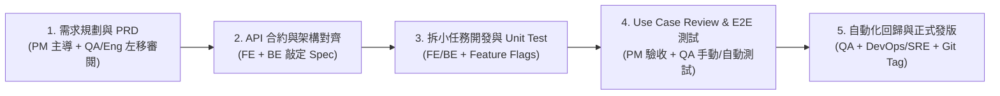

# 跨職能研發協作指南：PM、前後端、QA 與 SRE 職責邊界與交付標準

## 1. 目標與適用情境

在敏捷開發（Scrum / Kanban）與前後端分離架構下，最常見的團隊內耗來自於**「規格邊界模糊」、「大功能一次丟出導致修 A 壞 B」**以及**「環境與測試權責不清」**。
本 Playbook 結合 [[sources/2026-11-12-how-to-work-with-qa-3pmlab|3PM Lab 跨職能測試與協作心法]] 與現代研發流程，定義 **PM、Frontend (FE)、Backend (BE)、QA 與 DevOps/SRE** 在軟體開發生命週期（SDLC）各階段的職責邊界與交付標準。

---

## 2. 各角色職責分工與品質把關矩陣 (RACI)

軟體品質並非 QA 單一角色的責任，而是由五個職能在不同階段層層把關：

| 階段 / 活動 | PM (產品經理) | Frontend / Backend (工程師) | QA (品質保證) | DevOps / SRE | 核心交付物 (Deliverables) |
| :--- | :--- | :--- | :--- | :--- | :--- |
| **1. 需求探索與 Refinement** | **主責 (R)**：撰寫 PRD、User Story 與商業驗收條件。 | **協作 (C)**：評估技術可行性、資料庫影響與工時，將大功能切分為小 Phase。 | **左移介入 (C)**：**在 PRD 階段即加入偵錯**，挑出極端邊界條件（Edge Cases）與跨模組相依性（Dependencies）。 | **諮詢 (I)**：評估是否需新增雲端基礎設施或第三方服務。 | 定稿之 PRD、切分後的 Jira Tickets |
| **2. 介面與 API 規格設計** | 確認 UI/UX 流程符合商業邏輯。 | **主責 (R)**：前後端共同制定 **API Contract（Swagger / OpenAPI）**，敲定路徑、參數、錯誤碼與 JSON 結構。 | 依據 PRD 與 API 規格開始撰寫 **Test Plan / Test Cases**（管理於 TestRail 等工具）。 | 規劃 [[tools/kubernetes|K8s]] `ConfigMap` / `Secret` 與網路路由 (`Ingress`)。 | OpenAPI Spec 文件、Mock Server、Test Cases 清單 |
| **3. 開發與單元測試** | 追蹤進度，解答開發過程中的規格疑問。 | **主責 (R)**：遵循 [[playbooks/git-version-control-and-history-management|Atomic Commit 規範]] 開發、撰寫 **Unit Test**、執行同儕 **Code Review**，並對未完功能加上 **Feature Flag**。 | 準備測試環境資料與自動化測試腳本。 | 維護 CI Pipeline（自動跑 Linter 與 Unit Test）。 | PR / Merge Request、Unit Test 報告 |
| **4. 整合測試與 Use Case Review** | **主責 (R)**：與設計師進行 **Use Case Review (UAT)**，對照 PRD 與 Mockup 檢查核心體驗。 | **協作 (C)**：快速修復 QA 開立之 Defect，確保不引發連鎖錯誤。 | **主責 (R)**：執行 **Integration & E2E 手動測試**（含正常、極端、未登入/已登入、跨裝置與權限測試）。 | 確保 Staging / QA 測試環境穩定可用。 | Bug Reports（含重現步驟與錄影）、QA Sign-off |
| **5. 上線前把關與正式發布** | 確認發版範疇與對外 Release Notes，決定何時打開 Feature Flag。 | 合併至主幹分支並遵循 [[playbooks/git-version-control-and-history-management|Git Tag 規範]] 標記版號（如 `v1.2.0`）。 | **主責 (R)**：觸發上線前最後一道關卡——**核心模組自動化回歸測試 (Regression Testing)**。 | **主責 (R)**：與 QA 配合執行 CI/CD 滾動部署、監控 [[tools/kubernetes|K8s Probes]]、P99 Latency 與錯誤率告警。 | 線上穩定服務、監控 Dashboard |

---

## 3. 五大核心協作守則 (Standard Operating Procedures)

### 3.1 守則一：推行「測試左移 (Shift-Left Testing)」——讓 QA 參與 PRD 審查
- **痛點**：若等工程師全部寫完才把功能丟給 QA，此時才發現「A 功能開啟時會跟既有的 B 模組衝突」或「PRD 漏定義了退款失敗的狀態」，重構成本極高。
- **SOP**：
  - 因為 QA 同時測試全公司多個模組，往往是**全團隊最清楚跨模組細節與邊界條件的人**。
  - 在舉辦 Backlog Refinement / PRD Review 會議時，**必須邀請 QA 參加**，請 QA 從「這要怎麼測、有哪些連動模組」的角度提前抓出規格漏洞。

### 3.2 守則二：PM 交付給 QA 的「結構化測試維度清單」
PM 在交付 PRD 時，除了主幹流程外，應同步附上一份概要檢查維度清單，協助 QA 快速展開完整的 Test Cases：
- [ ] **情境覆蓋**：正常流程（Happy Path）、極端數值/邊界情境（Edge Cases）、錯誤輸入與例外處理（Error Handling）。
- [ ] **身分與權限狀態**：未登入訪客、一般登入會員、VIP/不同 RBAC 角色權限。
- [ ] **功能開關組合**：已開啟 vs 未開啟關聯功能 A 的舊用戶，在使用新功能 B 時的相容性。
- [ ] **環境矩陣**：目標支援的裝置（Desktop / iOS / Android）、螢幕解析度與瀏覽器版本。

### 3.3 守則三：切小交付顆粒度 + 善用 Feature Flags（功能開關）
- **Anti-pattern（大爆炸式交付）**：一個史詩級大功能開發 3 週後一次丟給 QA，瞬間測出 15 個 Bug；工程師緊急修改 15 個地方後，結果「修好 A 卻弄壞了 B」，導致發版無限期延宕。
- **SOP（小步快跑 + Feature Flags）**：
  1. PM 與工程師將大功能拆分為 4~5 個獨立的小 Phase / 小任務。
  2. 工程師在程式碼中包裹 **Feature Flag（功能開關）**。
  3. 當第 1 個小任務開發完成並通過 QA 測試（可能只有 2 個小問題，極易修復），就**先把程式碼 Merge 並部署上線（但 Feature Flag 預設關閉，終端用戶看不見）**。
  4. 如此既能大幅降低單次 Code Review 與 QA 測試的認知負荷，也能避免長期未合併的 Git 分支產生巨量 Merge Conflict（參見 [[playbooks/git-version-control-and-history-management|Git 版本控管實戰指南]]）。

### 3.4 守則四：排程必須預留「測試與來回修正 Buffer Time」
- **認知對齊**：「工程師改一行 `if-else` 邏輯只需 10 分鐘，但 QA 驗證這一行邏輯可能要測 20 種組合並花費半天。」
- **SOP**：
  - 專案排程（Sprint Planning）時，**測試時間絕不能壓在死線最後一刻**。
  - 必須預留「QA 撰寫測項 ➔ 執行測試 ➔ 錄製 Bug 重現步驟（Reproduction Steps）➔ 工程師修復 ➔ QA 二次驗證與 Regression Test」的來回（Back-and-forth）緩衝時間。

### 3.5 守則五：自動化回歸測試守住核心金流與主幹流程
- **分工原則**：
  - **手動測試**聚焦於：當次 Sprint 新增功能的細節、UI/UX 互動順暢度、探索性極端情境。
  - **自動化測試（E2E / Integration）**聚焦於：當新版本 Merge 到主分支、準備上線前，自動掃描**全站既有核心命脈（如：註冊、登入、加入購物車、結帳扣款）**，確保新程式碼沒有破壞既有功能，並隨每次迭代逐步將穩定後的新功能納入自動化覆蓋範圍。

---

## 4. 關聯頁面
- [[playbooks/git-version-control-and-history-management|Git 版本控管與歷史紀錄管理實戰指南]]
- [[tools/kubernetes|Kubernetes (K8s) 容器編排與雲端原生基建實務]]
- [[sources/2026-11-12-how-to-work-with-qa-3pmlab|來源摘要：【PM夥伴攻略】如何跟QA合作？ (3PM Lab)]]
