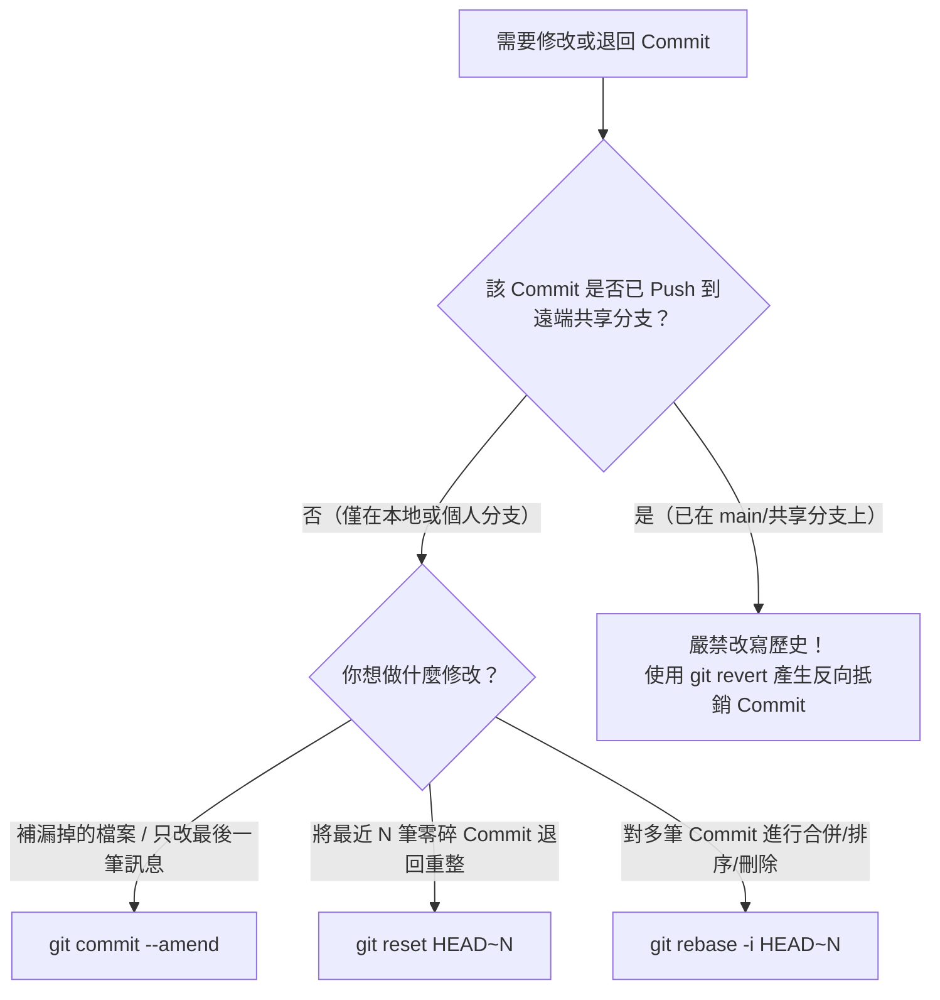

# Git 版本控管與歷史紀錄管理實戰指南

## 1. 目標與適用情境

本 Playbook 旨在規範工程團隊日常使用 [[tools/git|Git]] 時的**版本歷史整潔度**、**緊急插單與單點釋出流程**，以及**退版與修改歷史的安全決策邊界**，避免團隊因誤用 `reset`、`amend` 或混亂的 Commit 顆粒度而在發版與排查時陷入泥淖。

---

## 2. 核心原則：Atomic Commit（原子化提交）

在執行任何進階 Git 操作前，最關鍵的工程紀律是**「讓每個 Commit 具備高獨立性（Atomic Commit）」**：
- **單一職責**：一個 Commit 只做一件事（例如：重構某個 Service、修補某個 NPE Bug、新增一張資料表 Migration），不要把「修 A Bug + 順手排版 B 檔案 + 新增 C 功能的一半」塞在同一個 Commit。
- **可獨立編譯與測試**：理想情況下，切換到任一個 Commit 節點，系統都應該是可建置、測試可通過的狀態。
- **實務收益**：
  1. 當 PM 或老闆臨時要求**「把開發分支裡的某個小功能單獨拉出來上線」**時，可以直接一行 `git cherry-pick <commit-hash>` 無痛搬移，而不會夾帶未完成的半成品程式碼。
  2. 當線上發生故障需要退版時，可以直接針對該筆 Commit 執行 `git revert <commit-hash>`，不會誤傷其他正常功能。

---

## 3. 標準操作流程 (SOP) 與決策樹

### 3.1 決策樹：我想修改或退回已經 Commit 的紀錄，該用哪個指令？

面對歷史修改需求時，**第一判斷準則永遠是：「這筆 Commit 是否已經 Push 到遠端共享分支（如 `main`、`develop`）？」**



---

### 3.2 `git reset` 三種模式深度解析 (`--soft` vs `--mixed` vs `--hard`)

在個人開發過程中，常會先產生許多測試性質的零碎 Commit，最後準備發 PR 前再用 `git reset HEAD~N` 退回並重新整理成乾淨的 Commit。理解 Git 的三個區域（Working Directory 工作區、Staging Area 暫存區、Repository 儲存庫）與三種參數至關重要：

| 模式參數 | HEAD 指標移動 | Staging Area (暫存區) | Working Directory (工作區檔案) | 實務最佳適用場景 |
| :--- | :---: | :---: | :---: | :--- |
| **`--soft`** | 退回 N 步 | **保留**（檔案處於已 `git add` 狀態） | **保留**（程式碼不變） | **合併零碎 Commit 首選**：`git reset --soft HEAD~3` 後直接 `git commit -m "feat: ..."` 即可將 3 筆合成 1 筆。 |
| **`--mixed`** *(預設)* | 退回 N 步 | **清空**（需重新 `git add`） | **保留**（程式碼不變） | `git reset HEAD~2` 預設行為。適合退回後想重新挑檔案、拆分成不同 Commit 的情境。 |
| **`--hard`** | 退回 N 步 | **清空** | **直接抹除修改！**（還原到目標 Commit 狀態） | **高危險指令**：徹底放棄最近 N 筆 Commit 與所有未提交修改。若誤按，請立即用 `git reflog` 救回。 |

---

### 3.3 情境 SOP 1：開發途中遭遇「隕石插單 / 緊急 Hotfix」

當你在 `feature/payment` 改到一半，線上突然爆出 P0 Bug 需要立刻切回 `main` 修補：

```bash
# Step 1: 不要勉強 commit 半成品！將當前修改（含新建未追蹤檔案）存入暫存倉
$ git stash push -u -m "WIP: payment gateway integration"

# Step 2: 切換至 main 並拉取最新進度，開出 hotfix 分支
$ git switch main
$ git pull origin main
$ git switch -c hotfix/fix-null-pointer

# Step 3: 修復 Bug、提交、推送並合併後，切回原開發分支
$ git switch feature/payment

# Step 4: 將暫存的程式碼取回工作區繼續開發
$ git stash pop
```

---

### 3.4 情境 SOP 2：從長期開發分支單獨抽離小功能提前釋出 (`cherry-pick`)

當 `feature/v2-redesign` 已經開發兩週、累積了 20 個 Commit，但 PM 希望把其中一個已經寫好的「匯出 CSV 小功能」（Commit Hash 為 `abc1234`）今天就先放到 `main` 上線：

```bash
# Step 1: 在原分支確認該功能的 Commit Hash
$ git log --oneline feature/v2-redesign

# Step 2: 切換到目標主幹分支（或基於 main 開出的 release 分支）
$ git switch main
$ git pull origin main

# Step 3: 精準摘取該筆 Commit（Git 會自動複製該次變更並建立一筆新的 Commit）
$ git cherry-pick abc1234
```
> [!TIP] 實務建議
> 若 `cherry-pick` 過程中發生衝突（因為 `feature/v2-redesign` 改動了其他上下文），解決衝突後執行 `git add .` 與 `git cherry-pick --continue`；若決定放棄摘取，執行 `git cherry-pick --abort` 即可安全退回。

---

### 3.5 情境 SOP 3：安全退回兩個月前的線上問題程式碼 (`revert`)

當某筆在兩個月前合併進 `main` 的 Commit（例如 `def5678`）被發現有隱性邏輯漏洞，但後面已經疊加了上百個新 Commit：

```bash
# 切勿使用 git reset！這會把兩個月來所有人的心血全部洗掉。
# 使用 git revert 產生一筆「完全相反」的新 Commit：
$ git revert def5678
```
- **效果**：Git 會計算 `def5678` 的反向 Diff（原本新增的就刪除、原本刪除的就加回），並產生一筆新的 Commit（預設訊息為 `Revert "原 Commit 訊息"`，並附上被 Revert 的 Hash）。
- **優勢**：完整保留歷史紀錄，不會影響後續的 100 筆 Commit，且可直接安全 `git push` 到遠端觸發 CI/CD 重新部署。

---

### 3.6 情境 SOP 4：正式版號錨定 (`git tag`)

當 `main` 分支完成 QA 驗收、準備正式對外發佈（Release）時，必須使用 Tag 錨定版本（建議採用語意化版本 Semantic Versioning `vMajor.Minor.Patch`）：

```bash
# 在目標發版分支建立附註標籤 (Annotated Tag，會紀錄建立者、時間與發版說明)
$ git tag -a v1.0.0 -m "Release v1.0.0: Initial production release"

# 將標籤推送至遠端儲存庫（預設 git push 不會推送 tag）
$ git push origin v1.0.0
```

---

## 4. 關聯頁面
- [[tools/git|Git 分散式版本控制系統實務]]
- [[sources/2026-11-12-advanced-git-johnliu|來源摘要：後端工程師的第二堂課 (1) 進階 Git]]
