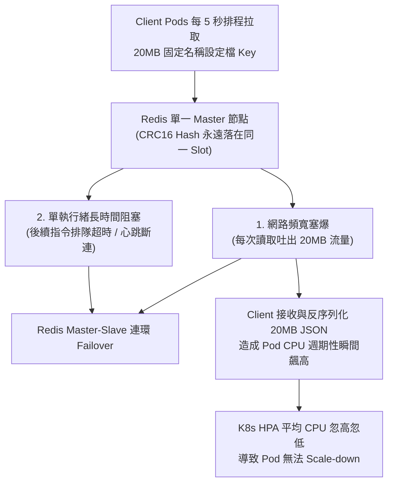

# 事故覆盤：Redis HotKey 與 20MB BigKey 引發叢集 Failover 與 K8s HPA 失靈

## 1. 事故背景與影響範圍

- **案例來源**：新加坡商鈦坦科技 (Titansoft) 生產環境真實案例（詳見 [[sources/2026-11-12-redis-hotkey-bigkey-titansoft|原始分享摘要]]）。
- **涉及元件**：後端微服務（部署於 [[tools/kubernetes|Kubernetes]] 並啟用 `HPA` 自動擴縮）與 [[tools/redis|Redis Cluster]] 分散式快取叢集。
- **業務與系統影響**：
  1. 尖峰時段 [[tools/redis|Redis Cluster]] 發生單一節點 CPU 飆高、網路頻寬塞爆、**OOM（記憶體耗盡）觸發 Key 強制逐出導致快取資料遺失**，以及 **Master-Slave 反覆觸發故障轉移（Failover）**。
  2. 後端 Client 服務受到 Redis 回應延遲與大量資料反序列化拖累，導致 **K8s Pod 擴容（Scale-up）至上限後完全無法縮容（Scale-down）**，造成雲端運算資源嚴重浪費與服務不穩。

---

## 2. 現象與指標異常 (Symptoms & Metrics)

排查初期觀察到四項明顯的監控指標異常：
1. **K8s HPA 縮容卡死**：Client 端服務的 Pod 數量在尖峰擴增到最高點後，即便離峰也降不下來。
2. **Client Pod CPU 劇烈震盪**：檢查 Pod 指標發現 CPU 平均使用率呈現鋸齒狀「忽高忽低」，剛好卡住 HPA 的縮容冷卻與閾值判斷。
3. **Redis Cluster 負載極度傾斜**：明明部署了多節點的 Redis Cluster，卻只有**其中一台 Master Node** 的 CPU 與 **Network Output（網路流出頻寬）** 遠高於其他節點。
4. **Redis OOM 與 Failover 告警**：該台高負載 Master Node 頻繁觸發 OOM 事件（開始依 `maxmemory-policy` 逐出其他正常 Key）並發生主從切換（Failover）。

---

## 3. 排查過程 (Troubleshooting Trail)

### 第一階段 (Part 1)：鎖定並處理 HotKey
1. **假設與驗證**：看到單一節點 CPU High 與 Network 傾斜，首先懷疑存在 **HotKey（熱點鍵）**。
2. **定位工具**：確認 Redis 啟用 `allkeys-lfu` 策略後，執行內建掃描指令：
   ```bash
   $ redis-cli -h <address> -p <port> -a <password> --hotkeys
   ```
   抓出一個固定名稱的設定檔 Key（如 `xxxSetting`），其 8-bit LFU Counter 高達最大值 **`255`**（代表約百萬次訪問級別）。
3. **第一波處置 (Workaround)**：
   - 透過 `Redis-Insight` 手動將這個固定名稱 HotKey 所屬的 Hash Slot 搬移（Reshard）到較清閒的 Node 上。*(期間踩坑筆記：千萬不能把 Master 的 Slot 全部搬空，否則該 Master 會自動降級為 Slave！)*
   - 同時為 Redis Cluster 擴增 **2 組 Master-Slave 節點**（增加分母），讓其他浮動名稱的 Key（如 `user_info_{id}`）能被打散，並擴大總記憶體容量。
4. **第一階段結果**：
   - **改善部分**：擴容後 **OOM 不再發生**，成功止住 Key 被強制逐出造成的資料遺失。
   - **未解問題**：到了週末流量高峰，**被放入該問題 Key 的那台 Node 依然獨自飆高忙碌，並再次發生多次 Master-Slave 互相 Failover！** 顯然單純「搬移 Slot」與「加機器」無法解決單一 Key 本身的破壞力。

---

### 第二階段 (Part 2)：深挖揪出 20MB 的致命 BigKey
1. **深入排查**：為何單一 Key 會讓整台 Redis Node 的網路頻寬（Network Output）爆表並卡死單執行緒？團隊進一步執行 BigKey 掃描：
   ```bash
   $ redis-cli -h <address> -p <port> -a <password> --bigkeys
   ```
2. **真相大白**：發現那個百萬級訪問的 `HotKey`，竟然同時是一個 **體積高達 20MB 的 `BigKey`**！而且所有 Client Pod 每隔 **5 秒鐘** 就會透過排程（Schedule）去拉取一次這個 20MB 的巨型 Key！

---

## 4. 根本原因分析 (Root Cause Analysis)

本次事故是典型的 **「HotKey + BigKey = Double Kill」複合型架構反模式**：



1. **為什麼擴充 Cluster 節點沒用？**
   因為該 Key 名稱固定（非 `key_{id}`），在 Redis Cluster 的 16,384 個 Hash Slots 演算法下，它永遠只會落在同一台實體節點上。
2. **為什麼會觸發 Failover？**
   Redis 核心為單執行緒，高頻率讀取與傳輸 20MB 數據不僅打爆網卡 Output 頻寬，更阻塞主執行緒處理其他指令與集群 Gossip 心跳檢查；當阻塞超過 Cluster Node Timeout，集群便判定該 Master 死機而啟動 Failover（但切換到新升上來的 Master 後，20MB 流量又立刻把新 Master 打死，形成無限互踢）。
3. **為什麼 K8s HPA 降不下來？**
   每個 Client Pod 每 5 秒拉回 20MB 資料並在記憶體中進行龐大的反序列化（Deserialization），導致 Client CPU 每隔幾秒就出現一次尖峰突波，使 HPA 計算出的平均 CPU 無法穩定低於縮容門檻。

---

## 5. 短期止血與長期改善 (Action Items)

### 短期止血 (Mitigation / Workaround)
- [x] **調降 Client 輪詢頻率**：將 Client 端 Schedule 拉取該設定 Key 的週期從 **每 5 秒一次改為每 1 分鐘一次**，瞬間將網卡流量與 CPU 負載砍降 90% 以上。
- [x] **Slot 故障隔離**：在還沒改完程式拆分 Key 前，先將該台 Node 上的**其他正常 Slot 全部搬移到另外 4 台 Node**，讓這台機器「專職」只服務這個 20MB 的 BigKey，避免拖累其他正常業務查詢。

### 長期根治 (Root Fix & Prevention)
- [x] **拆分 BigKey（架構重構）**：修改應用程式讀寫邏輯，**將原本 20MB 的巨型 Key 拆分為多個獨立的小 Key**（按功能模組或子項目拆分），使熱點與資料量能均勻分散至 Redis Cluster 的不同節點上。
- [x] **建立快取治理規範**：將 `--hotkeys` 與 `--bigkeys` 納入日常維運巡檢，嚴禁在單一 String Key 存入超過數 MB 的巨型結構（參見 [[tools/redis|Redis 實務規範]] 與 [[concepts/caching-strategies-and-pitfalls|快取設計指南]]）。

---

## 6. 關聯頁面
- [[tools/redis|Redis 分散式快取與記憶體資料庫實務]]
- [[tools/kubernetes|Kubernetes (K8s) 容器編排與雲端原生基建實務]]
- [[concepts/caching-strategies-and-pitfalls|快取策略與三大災難防禦 (Caching Strategies & Pitfalls)]]
- [[sources/2026-11-12-redis-hotkey-bigkey-titansoft|來源摘要：Redis HotKey 與 BigKey 造成的一系列災難 (鈦坦科技)]]
